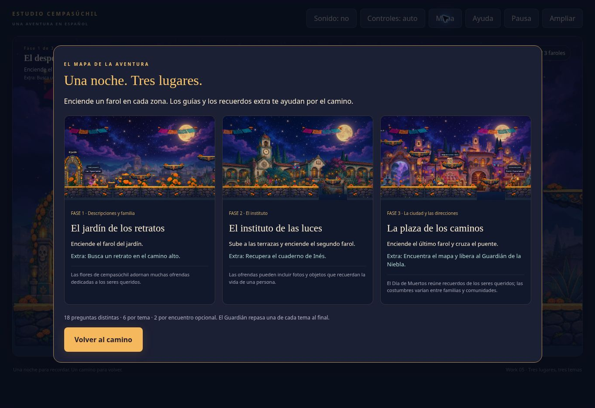

# Work 05 — tres lugares, tres temas

Versión de revisión del mismo nivel, en la rama work/05-fases-tematicas.

- Jardín de los retratos: descripciones y familia.
- Instituto de las luces: asignaturas, horario y vida escolar.
- Plaza de los caminos: ciudad, direcciones, transporte y planes.

18 preguntas distintas, seis por tema, en nueve encuentros opcionales de dos preguntas. El Guardián repasa una de cada tema. Se añaden dos panoramas ilustrados, seis objetos, tres recuerdos extra y un mapa de las fases.

[Banco con respuestas y pistas](authoring/docs/06-banco-de-preguntas.md) · [Informe de cambios y pruebas](authoring/docs/07-work05-fases-tematicas.md).

41 pruebas superadas. Chrome remoto: inicio del HTML, diálogos, reintento, pistas, retorno a la segunda pregunta, botón Hablar y victoria automatizada con las 18 preguntas. Safari de iPad real, varios dedos reales y valoración de una primera partida humana siguen pendientes.

El index.html de esta rama es autónomo. Para reconstruir desde authoring: python3 extract-assets.py; npm test; python3 bundle.py. Los nuevos PNG maestros se incluyen en authoring/assets/source-work05.

La versión pública continúa en main; esta rama no está desplegada.
